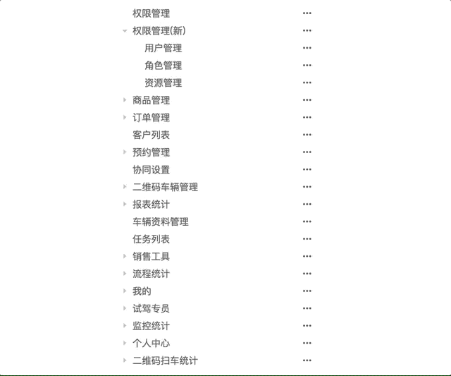
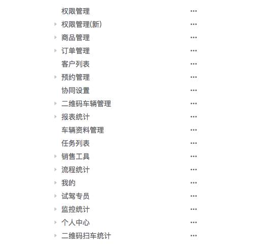
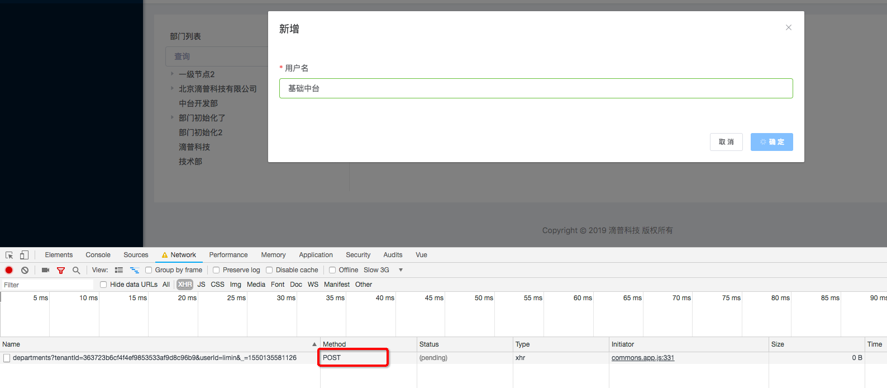
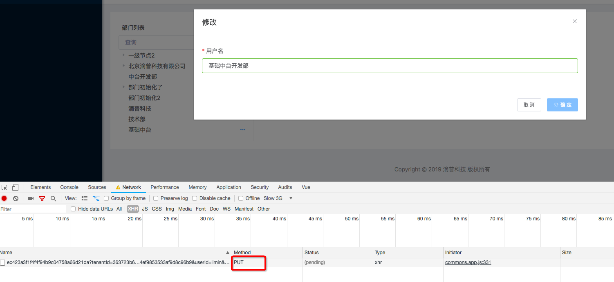
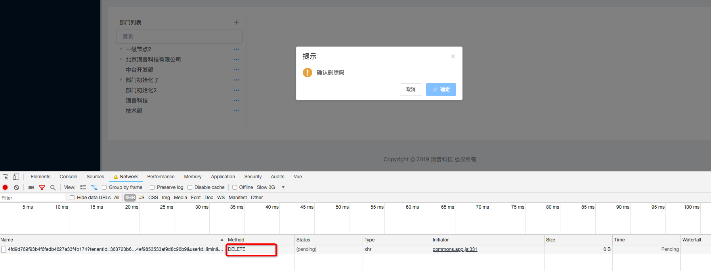

# el-data-tree

使用`axios`自动发送请求，支持筛选, 自定义操作列, 让 RESTful 风格的 CRUD 更简单 👏



## Table of Contents

* **[Introduction](#introduction)**
* **[Feature](#feature)**
* **[Documentation](#documentation)**
* **[Demo](#demo)**
* **[Install](#install)**
* **[Quick Start](#quick-start)**
* **[Example](#example)**
  * **[basic](#basic)**
  * **[url](#url)**
  * **[extraButtons](#extraButtons)**
  * **[beforeConfirm](#beforeConfirm)**
  * **[onDelete](#onDelete)**
  * **[drag](#drag)**
* **[Api](#api)**
  * **[Attributes](#attributes)**
  * **[Methods](#methods)**
  * **[Events](#events)**
  * **[Scoped Slot](#scoped-slot)**
* **[License](license)**

## Introduction

### CRUD

el-data-tree 就是为了解决业务问题而生的，故而封装了 CRUD 的逻辑在里面。

以用户接口示例，设其相对路径为:

```sh
/api/v1/users
```

则其 restful CRUD 接口如下：

* 查询

```sh
GET /api/v1/users?type=1
```

* 新增

```sh
POST /api/v1/users
```

* 修改(编辑)

```sh
PUT /api/v1/users/:id
```

* 删除

```sh
DELETE /api/v1/users/:id
```

则只需要使用以下代码，即可完成 CRUD 功能

```vue
<template>
  <el-data-tree v-bind="treeConfig"></el-data-tree>
</template>
```

```js
<script>
export default {
  data() {
    return {
      treeConfig: {
        url: '/example/users',
        dataPath: 'data.payload',
        showFilter: true,
        form: [
          {
            $type: 'input',
            $id: 'name',
            label: '用户名',
            $el: {
              placeholder: '请输入'
            },
            rules: [
              {
                required: true,
                message: '请输入用户名',
                trigger: 'blur'
              }
            ]
          }
        ]
      }
    }
  }
}
</script>
```

效果如下：

* 查询



* 新增



* 修改



* 删除



[⬆ Back to Top](#table-of-contents)

## Feature

* 只需进行 json 配置，即可实现 restful 风格的 CRUD 四个接口的对接
* 可扩展自定义菜单栏，以及自定义操作函数
* 默认保存展开状态，新增、删除、编辑不丢失该状态
* 优化节点勾选方法

[⬆ Back to Top](#table-of-contents)

## Demo

you can run demo on your localhost, just follow these scripts

```bash
# clone the source code
git clone https://github.com/FEMessage/el-data-tree.git

# enter the directory
cd el-data-tree

# install the dependencies
yarn

# run demo in ./stories
yarn storybook
```

[⬆ Back to Top](#table-of-contents)

## pre install

this component peerDependencies on [element-ui](http://element.eleme.io/#/zh-CN/component/tree) and [el-form-renderer](https://github.com/FEMessage/el-form-renderer) and [axios](https://github.com/axios/axios)

make sure you have installed in your project

```sh
yarn add element-ui @femessage/el-form-renderer axios
```

if you want to develop the component on your localhost, you should install with -P

```sh
yarn add element-ui @femessage/el-form-renderer axios -P
```

[⬆ Back to Top](#table-of-contents)

## Install

encourage using [yarn](https://yarnpkg.com/en/docs/install#mac-stable) to install

```sh
yarn add @femessage/el-data-tree
```

[⬆ Back to Top](#table-of-contents)

## Quick Start

### global register component

this is for minification reason: in this way building your app,

webpack or other bundler just bundle the dependencies into one vendor for all pages which using this component,

instead of one vendor for one page

```js
import Vue from 'vue'

// register component and loading directive
import ElDataTree from '@femessage/el-data-tree'
import ElFormRenderer from '@femessage/el-form-renderer'
import {
  Button,
  Dialog,
  Dropdown,
  DropdownMenu,
  DropdownItem,
  Form,
  FormItem,
  Input,
  Loading,
  Tree,
  MessageBox,
  Message
} from 'element-ui'

Vue.use(Button)
Vue.use(Dialog)
Vue.use(Dropdown)
Vue.use(DropdownMenu)
Vue.use(DropdownItem)
Vue.use(Form)
Vue.use(FormItem)
Vue.use(Input)
Vue.use(Loading.directive)
Vue.use(Tree)
Vue.component('el-form-renderer', ElFormRenderer)
Vue.component('el-data-tree', ElDataTree)

// to show confirm before delete
Vue.prototype.$confirm = MessageBox.confirm
// if the tree component cannot access `this.$axios`, it cannot send request
import axios from 'axios'
Vue.prototype.$axios = axios
```

[⬆ Back to Top](#table-of-contents)

### template

```vue
<template>
  <el-data-tree></el-data-tree>
</template>
```

[⬆ Back to Top](#table-of-contents)

## Example

### basic

suppose the api response looks like this:

```js
{
  "code": 0,
  "msg": "ok",
  "payload": {
    "content": [] // the data to render
  }
}
```

we get setting

```vue
<el-data-tree
  dataPath="payload.content"
>
</el-data-tree>
```

that's the default setting, you can get your custom setting according to your api

now I'll show you more code example, here we go🚴

[⬆ Back to Top](#table-of-contents)

### url

```vue
<!-- template -->
<el-data-tree
  :url="url"
>
</el-data-tree>
```

```js
// script
export default {
  data() {
    return {
      url:
        'https://www.easy-mock.com/mock/5c6783930df0c43ba31aca2b/femessage-mock/el-data-tree/on-get'
    }
  }
}
```

> if `url` change, the tree will reload

[⬆ Back to Top](#table-of-contents)

### new/edit form

this will show new or edit form, when you click new or edit button

```vue
<!-- template -->
<el-data-tree
  :url="url"
  :form="form"
>
</el-data-tree>
```

```js
// script
form: [
  {
    $type: 'select',
    $id: 'backendFramework',
    label: '后端框架',
    rules: [{required: true, message: '请选择后端框架', trigger: 'blur'}],
    $options: ['DUBBO', 'HSF'].map(f => ({label: f, value: f})),
    $el: {
      placeholder: '请选择'
    }
  },
  {
    $type: 'input',
    $id: 'name',
    label: '名称',
    rules: [
      {
        required: true,
        message: '请输入名称',
        trigger: 'blur',
        transform: v => v && v.trim()
      }
    ],
    $el: {placeholder: '请输入'}
  }
]
```

[⬆ Back to Top](#table-of-contents)

### extraButtons

extra buttons in operation column

> attention: click function called `atClick`

```vue
<!-- template -->
<el-data-tree
  :url="url"
  :extraButtons="extraButtons"
>
</el-data-tree>
```

```js
// script
extraButtons: [
  {
    type: 'primary',
    text: '跳转',
    // data参数表示该节点所对应的对象,node表示当前节点
    atClick: (data, node) => {
      alert('跳转' + data.id)
      return Promise.resolve()
    }
  }
]
```

[⬆ Back to Top](#table-of-contents)

### beforeConfirm

在新增/修改弹窗点击确认, 并完成表单 form 表单校验后调用，需要返回 Promise.
如果 resolve, 则会发送新增/修改请求; 如果 reject, 则不会发送新增/修改请求.
参数: (data, isNew) data 为表单数据, isNew true 表示是新增弹窗, false 为 编辑弹窗

```vue
<el-data-tree
  :beforeConfirm="beforeConfirm"
>
</el-data-tree>
```

```js
beforeConfirm(data, isNew) {
  console.log(data, isNew)

  if (isNew) {
	alert('新增可以发送请求')
	return Promise.resolve()
  } else {
	alert('修改不可以发送请求')
	return Promise.reject()
  }
}
```

[⬆ Back to Top](#table-of-contents)

### onDelete

默认情况下:

* 删除的请求格式是 DELETE url/id

当不满足需求时, 可以使用 onDelete, 自定义删除方法, 返回 promise

```vue
<el-data-tree
  onDelete="onDelete"
>
</el-data-tree>
```

```js
import Axios from 'axios'

onDelete: (data, node) => {
  return Axios.delete(
    'https://www.easy-mock.com/mock/5bbefdf6faedce31cd6a5261/example/on-delete',
    {
      data: {
        id: data.id
      }
    }
  )
}
```

[⬆ Back to Top](#table-of-contents)

### extraParams on new/edit

```js
extraParams: {
  version: 0,
  isParent: false
}
```

[⬆ Back to Top](#table-of-contents)

### customQuery on search

```js
customQuery: {
  type: this.$route.query.type
}
```

[⬆ Back to Top](#table-of-contents)

### drag

下面给出一个配合后台接口进行拖拽排序的例子，逻辑如下：

```vue
<el-data-tree
  :treeAttrs="{
    draggable: true,
    allowDrop: allowDrop
  }"
  @node-drop="onDrop"
>
</el-data-tree>
```

```js
import Axios from 'axios'

/**
 * 算法如下
 * 假设node为拖拽的节点，拖拽后的顺序为: prev, node, next, 则 sort = prev.sort
 * @param dragNode
 * @param dropNode
 * @param dropType
 * @param ev
 */
onDrop(dragNode, dropNode, dropType, ev) {
  const firstSort = -1

  // 默认是在后面插入
  let sort = dropNode.data.sort
  let parentId = dropNode.data.parentId

  // 变为子节点
  if (dropType === 'inner') {
    sort = firstSort
    parentId = dropNode.data.id
  }

  Axios.put(
    'https://www.easy-mock.com/mock/5bbefdf6faedce31cd6a5261/example/sort',
    {
      data: {
        id: dragNode.data.id,
        parentId,
        sort,
        tag: dropNode.data.tag
      }
    }
  )
},
allowDrop(dragNode, dropNode, dropType) {
  // 当 prev 时, 意味着得到的是node与next两个节点, 无法根据算法求出sort值, 故什么也不做
  return dropType !== 'prev'
}
```

效果如下：


## Api

### Attributes

| 参数          | 说明                                                                                                                                                                                                                                                       | 类型     | 默认值            |
| ------------- | ---------------------------------------------------------------------------------------------------------------------------------------------------------------------------------------------------------------------------------------------------------- | -------- | ----------------- |
| title         | 标题文字                                                                                                                                                                                                                                                   | String   | -                 |
| url           | 请求 url, 如果为空, 则不会发送请求; 改变 url, 则 tree 会重新发送请求                                                                                                                                                                                       | String   | -                 |
| treeAttrs     | el-tree 属性设置, 详情配置参考 [element-ui 官网](http://element-cn.eleme.io/#/zh-CN/component/tree)                                                                                                                                                        | Object   | -                 |
| parentKey     | 修改时会用到,请求会根据定义的属性值获取 parentKey,即 row[this.parentKey]                                                                                                                                                                                   | String   | parentId          |
| dataPath      | 接口返回的数据中的路径, 嵌套对象使用.表示即可                                                                                                                                                                                                              | Object   | payload.content   |
| showFilter    | 是否展示过滤框                                                                                                                                                                                                                                             | Boolean  | false             |
| checkedKeys   | 通过 checkedKeys 设置目前勾选的节点，支持.sync 修饰符                                                                                                                                                                                                      | Array    | -                 |
| extraButtons  | 操作列的自定义菜单, 渲染的是 element-ui 的 dropdown, 支持包括 style 在内的以下属性: {type: '', text: '', atClick: (data, node) => Promise.resolve(), show: (data, node) => return true 时显示 } 点击事件 data 参数表示该节点所对应的对象,node 表示当前节点 | Array    | -                 |
| form          | 弹窗表单, 用于新增与修改, 详情配置参考[@femessage/el-form-renderer](https://github.com/FEMessage/el-form-renderer/blob/master/README.md)                                                                                                                   | Array    | -                 |
| formAttrs     | 弹窗表单属性设置, 详情配置参考 [element-ui 官网](http://element.eleme.io/#/zh-CN/component/form#form-attributes)                                                                                                                                           | Object   | -                 |
| customQuery   | 外部的注入额外的查询参数, 键值对形式                                                                                                                                                                                                                       | Object   | -                 |
| extraParams   | 新增/修改提交时注入额外的参数                                                                                                                                                                                                                              | Object   | -                 |
| hasOperation  | 是否有操作列                                                                                                                                                                                                                                               | Boolean  | true              |
| hasTitle      | 是否有标题栏                                                                                                                                                                                                                                               | Boolean  | false             |
| hasDelete     | 是否有删除按钮                                                                                                                                                                                                                                             | Boolean  | true              |
| hasNew        | 是否有新增按钮                                                                                                                                                                                                                                             | Boolean  | true              |
| hasEdit       | 是否有编辑按钮                                                                                                                                                                                                                                             | Boolean  | true              |
| transform     | 用于转换获取的数据为目标数据                                                                                                                                                                                                                               | Function | -                 |
| onNew         | 点击新增按钮时的方法, 当默认新增方法不满足需求时使用, 需要返回 promise。参数(data, row) data 是 form 表单的数据, row 是当前行的数据                                                                                                                        | Function | -                 |
| onEdit        | 点击修改按钮时的方法, 当默认修改方法不满足需求时使用, 需要返回 promise。参数(data, row) data 是 form 表单的数据, row 是当前行的数据                                                                                                                        | Function | -                 |
| onDelete      | 点击删除按钮时的方法, 当默认删除方法不满足需求时使用, 需要返回 promise。参数(data, row) data 是 form 表单的数据, row 是当前行的数据                                                                                                                        | Function | -                 |
| beforeConfirm | 在新增/修改弹窗 点击确认时调用，返回 Promise, 如果 reject, 则不会发送新增/修改请求。 参数: (data, isNew) data 为表单数据, isNew true 表示是新增弹窗, false 为 编辑弹窗                                                                                     | Function | Promise.resolve() |
| newText       | 默认“新增”操作菜单文字                                                                                                                                                                                                                                     | String   | 新增              |
| editText      | 默认“修改”操作菜单文字                                                                                                                                                                                                                                     | String   | 修改              |
| deleteText    | 默认“删除”操作菜单文字                                                                                                                                                                                                                                     | String   | 删除              |

[⬆ Back to Top](#table-of-contents)

### Methods

| 方法名            | 说明              | 参数                          |
| ----------------- | ----------------- | ----------------------------- |
| fetchData         | 更新树形列表      | -                             |
| getTree           | 获取 el-tree 对象 | -                             |
| updateCheckedKeys | 选中指定节点      | 选中的节点的 key 所组成的数组 |

[⬆ Back to Top](#table-of-contents)

### Events

| 事件名称 | 说明                     | 回调参数                                                      |
| -------- | ------------------------ | ------------------------------------------------------------- |
| loaded   | 请求返回, 数据更新后触发 | 共两个参数，依次为：渲染 tree 的数据, 请求返回的完整 response |
| error    | 请求数据失败             | 返回 err 对象                                                 |

[⬆ Back to Top](#table-of-contents)

### Scoped Slot

| 名字  | 说明                                             |
| ----- | ------------------------------------------------ |
| title | 自定义标题内容                                   |
| form  | 额外的弹窗表单内容, 当 form 不满足需求时可以使用 |

[⬆ Back to Top](#table-of-contents)

## License

[MIT](./LICENSE)

[⬆ Back to Top](#table-of-contents)
